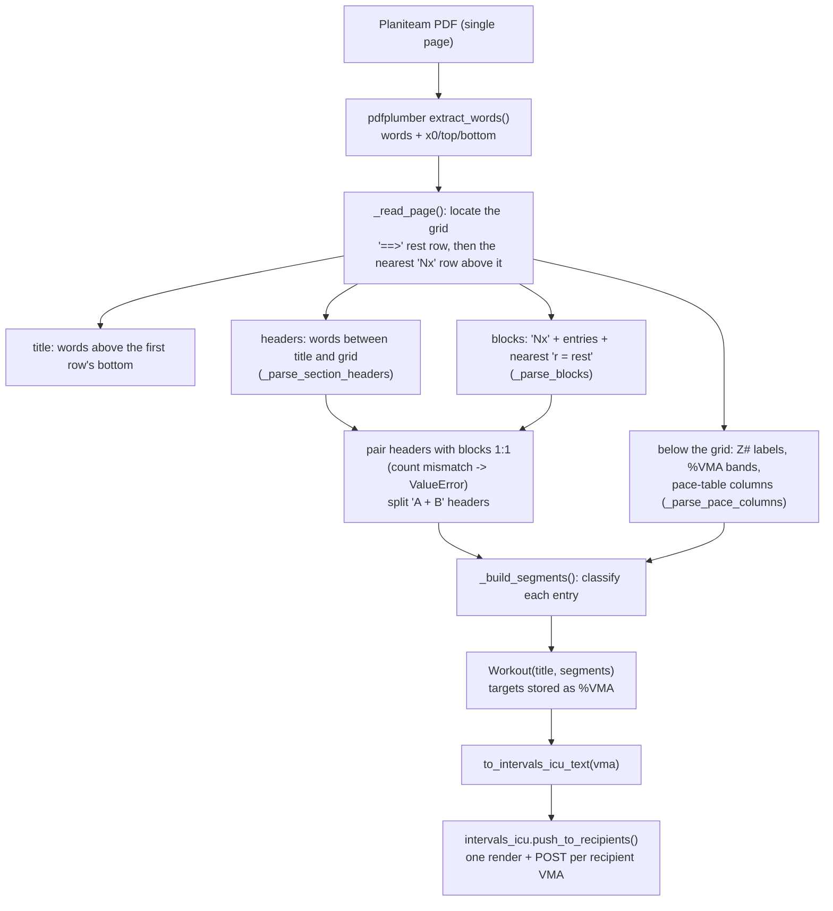
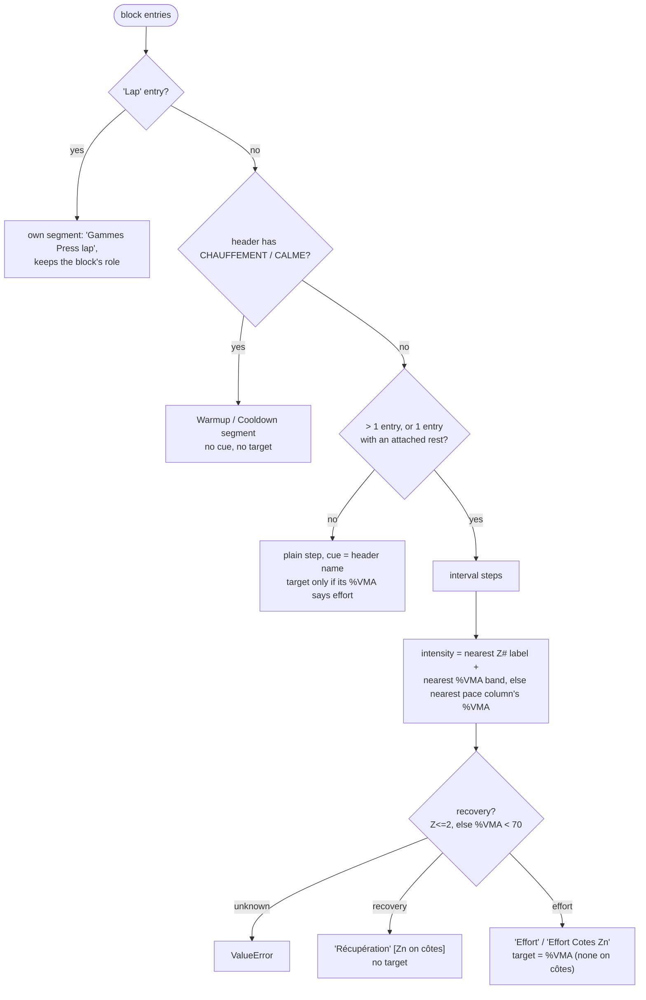

# Architecture

How a Planiteam PDF becomes intervals.icu structured-workout text. For *why*
each rule exists (and the live API probing behind it), see
[CLAUDE.md](CLAUDE.md).

## Modules

| Module | Role |
|---|---|
| `planiteam_to_coros.py` | PDF -> VMA-independent `Workout` -> text for a given VMA. Also the CLI. |
| `intervals_icu.py` | Recipients list, event payload, push (one event per recipient). |
| `main.py` | Cloud Function: parse the PDF once, push to every recipient. |

## Pipeline

Only relative positions are used: the grid rows are found from their
content, and everything else is defined as above, between or below them.
Entries are matched to rests, zone labels, %VMA bands and pace columns by
**nearest x0** within `_X_TOL` (20pt), never by order or count.

## Entry classification

An attached `r = rest` always becomes an extra untargeted `Récupération` step.

## Key data shapes

- **`Step`**: `duration_s` or `distance_m`, `cue`, `pace_pct` (`(lo, hi)`
  %VMA; equal bounds = single pace), `until_lap_press`.
- **`Segment`**: `name`, `repeat`, `role` (`"warmup"`/`"cooldown"`/`None`), steps.
- **`Workout`**: `title` + segments; `to_intervals_icu_text(vma)` renders it.
- **`_PaceColumn`**: one pace-table column; `vma_pct(distance_m)` averages
  the %VMA implied by every row (split-time cells are rescaled by distance).

## When a new PDF breaks

1. Run it through the CLI; the `ValueError` message names what didn't fit.
2. Dump `page.extract_words()` sorted by `(top, x0)` and compare landmarks
   (`==>`, `r =`, `Nx`, `Z\d`, pace cells) with a working sample.
3. Add the PDF and a hand-checked `expected.workout.intervals.txt` under
   `example/<date>/`; `tests/test_examples.py` picks it up automatically.
